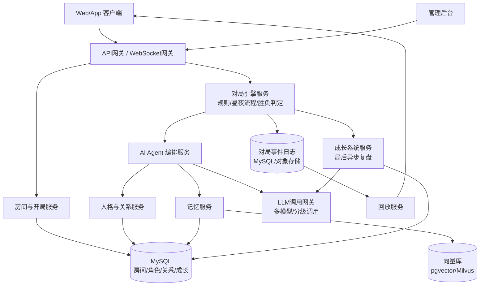

# AI狼人杀 产品设计与需求文档（PRD）

| 项目 | 内容 |
|---|---|
| 文档版本 | v0.6（补充夜间技能交互结算规则、阶段超时兜底机制、数据库索引设计、白狼王与警长/遗言的组合边界、最小可行接口契约；产品经理视角其余评审意见仍暂缓处理） |
| 更新日期 | 2026-09-11 |
| 文档定位 | 产品需求 + 技术架构（含数据库设计与Prompt工程方案） |
| 适用读者 | 产品/研发自用，作为个人全栈项目的设计蓝本 |

---

## 0. 需求追溯表

在展开设计前，先把你提出的三条核心诉求对应到本文档的具体章节，方便后续核对是否遗漏：

| 你的原始诉求 | 对应章节 |
|---|---|
| 1. AI角色可设定不同角色/性格，角色间可有beef和矛盾，角色数据需长期存储 | 第4章《AI角色人格系统》、第7章数据库设计中的 `ai_character`、`character_relationship`、`character_memory` |
| 2. 所有角色行为方式要和人一样，从0到100有成长性 | 第5章《AI拟人化行为引擎与成长体系》 |
| 3. 支持全AI对局和自定义AI人数/角色的开局 | 第3章《对局模式与开局配置》 |
| 4. 狼人杀标准角色和局型搭配需要可配置（而非写死） | 第3.4-3.6节、第7章 `role_definition`/`room_template` 表 |
| 5. 冷启动问题：新角色是"白板"，与"会记仇、会成长"的卖点脱节 | 第16章《冷启动与角色孵化方案》 |

---

## 1. 产品概述

### 1.1 背景与愿景

传统狼人杀游戏依赖真人凑局，存在"人不够开不了局""高质量对手难找""深夜想玩没人"等痛点。近两年LLM在角色扮演、多轮博弈推理上的能力已经足够支撑一个**具备真实人格、会推理、会伪装、会记仇、会成长**的AI玩家群体。

本项目的愿景是做一个「AI狼人杀」平台：AI不是简单的规则机器人，而是一批**拥有持久身份的数字玩家**——他们有名字、性格、说话习惯、跟谁关系好谁关系差，并且会随着打的局数增多变得越来越"老练"。玩家既可以和这些AI混战，也可以纯粹作为观众看一群AI互相对线、结盟、背叛、复仇。

### 1.2 产品定位

一句话定位：**"一个AI玩家会记仇、会变强的狼人杀平台"**。

核心差异化不在"规则引擎做得多标准"，而在于：
- AI角色的**人格长期一致性**（今天的AI和三个月后的AI，性格底色不变，但棋力更强、记忆更丰富）；
- AI之间**可累积的社交关系**（结怨、结盟会影响后续对局中的发言和投票倾向）；
- 一套可观测的**成长与分级体系**，让"打了500局的老油条AI"和"刚上线的新手AI"在行为上呈现明显差异。

### 1.3 目标用户与场景

| 用户类型 | 场景 |
|---|---|
| 普通玩家 | 深夜/凑不齐人时，拉几个AI凑一局9人标准局 |
| 硬核玩家 | 专门找"高等级"AI练习逻辑和心理博弈 |
| 观众/围观党 | 不参与，纯看AI互相飙演技、报仇、结盟（类似看AI直播/电子木鱼式娱乐） |
| 局座/房主 | 自定义开一整局纯AI观赏局，调整角色板和AI人格搭配制造"名场面" |
| 管理员（你自己） | 后台维护AI人格库、调整关系设定、监控成长曲线和对局质量 |

---

## 2. 核心概念定义

先统一几个贯穿全文的术语，避免后面歧义：

- **AI角色（Character）**：一个持久化的AI身份实体，拥有独立的人格设定、说话风格、关系网络、记忆库和成长数值。是"演员"，不是某一局游戏里的"临时工具人"。
- **对局身份（In-game Role）**：某个AI角色（或人类玩家）在某一局游戏里被分配到的狼人杀身份，如"预言家""狼人"，每局都会变。**AI角色 ≠ 对局身份**，一个角色可能这局是狼人下局是女巫。
- **阵营（Camp）**：狼人阵营/好人阵营/第三方阵营。
- **人格模板（Persona Template）**：定义角色性格的静态设定集合（人格向量+人物小传+说话风格）。
- **关系（Relationship）**：两个AI角色之间的长期社交状态，包含好感度和"beef"（宿怨/矛盾）记录。
- **成长维度（Growth Dimension）**：衡量AI"棋力"的多个独立能力轴，如逻辑推理力、伪装欺骗力等，每个维度0-100。

---

## 3. 对局模式与开局配置

### 3.1 三种对局模式（均支持）

1. **人机混战模式**：真人玩家和AI角色同局竞技，AI占据剩余席位。
2. **全AI观赏模式**：全部席位为AI角色，人类只能观战（可选是否公开"上帝视角"内心OS，见8.5节）。
3. **自定义开局模式**：房主自由指定总人数、角色板（狼人/预言家/女巫/猎人/守卫/白痴/平民等及数量）、AI与真人的比例、以及**具体指定某几个AI角色**入座（而非随机分配），从而可以人为制造"宿敌同局"的名场面。

三种模式在数据结构上不做区分，本质都是"房间配置的不同取值组合"，见3.2。

### 3.2 开局参数（房间配置 Schema）

```json
{
  "room_name": "6号包间",
  "mode": "custom",              // human_ai_mixed | all_ai | custom
  "total_seats": 9,
  "role_board": [
    { "role": "werewolf", "count": 3 },
    { "role": "seer", "count": 1 },
    { "role": "witch", "count": 1 },
    { "role": "hunter", "count": 1 },
    { "role": "villager", "count": 3 }
  ],
  "seats": [
    { "seat_no": 1, "occupant_type": "ai", "character_id": 1024 },
    { "seat_no": 2, "occupant_type": "ai", "character_id": 2048 },
    { "seat_no": 3, "occupant_type": "human", "user_id": 88 },
    { "seat_no": 4, "occupant_type": "ai", "character_id": null, "auto_match_tier": "gold" }
  ],
  "spectator_settings": {
    "public": true,
    "show_ai_inner_monologue": true
  },
  "difficulty_policy": "manual | auto_balance",
  "rule_config": {
    "enable_sheriff": true,
    "sheriff_vote_weight": 1.5,
    "witch_dual_potion_same_night": false,
    "witch_self_save_allowed": "first_night_only_disabled",
    "poison_death_has_last_words": false,
    "tie_vote_rule": "pk_speech_then_non_pk_revote",
    "irrationality_factor": 0.15,
    "same_night_guard_and_heal_rule": "target_dies",
    "turn_timeout_seconds": 30,
    "timeout_vote_policy": "abstain",
    "max_llm_retry": 2,
    "session_max_duration_minutes": 120
  }
}
```

要点：
- `occupant_type=ai` 且 `character_id` 为空时，系统按 `auto_match_tier`（对应成长等级分段，见5.2）自动从角色库随机抽取一个空闲AI角色入座，避免每次都要手动挑人。
- 角色板数量校验需保证阵营配比合理（内置几套经典配置模板：6人、9人、12人局，同时支持完全自定义）。
- `spectator_settings.show_ai_inner_monologue` 决定观众是否能看到AI的内部推理链（仅观赏局适用，人机混战局必须关闭，否则等于开天眼作弊）。
- `rule_config` 是新增的**规则基准配置**（对应骨灰玩家评审意见）：警长、女巫用药规则、遗言规则、平票规则、以及关系系统的非理性系数全部做成可配置项，而不是写死一套规则。默认值见14.2节的规则版本声明，`irrationality_factor` 的设计动机见4.2.1节；`same_night_guard_and_heal_rule` 见3.9.1节；`turn_timeout_seconds`/`timeout_vote_policy`/`max_llm_retry`/`session_max_duration_minutes` 是阶段超时兜底相关配置，见8.8节。

### 3.3 房间/对局生命周期状态机

```
CREATED → SEAT_FILLING → ROLE_ASSIGNING → SHERIFF_ELECTION(可选) → NIGHT_PHASE ⇄ DAY_PHASE → SETTLING → GROWTH_PROCESSING → ARCHIVED
```

- `SHERIFF_ELECTION`：`rule_config.enable_sheriff=true` 时才存在，发生在角色分配之后、首个夜晚开始之前，见3.7节；
- `NIGHT_PHASE ⇄ DAY_PHASE`：昼夜循环直到胜负判定；`DAY_PHASE` 内部包含"死亡公布→遗言（见3.8节）→讨论发言→投票→（如平票）PK发言→重新投票"的子流程；
- `SETTLING`：结算胜负、**公开所有玩家的真实身份**（`game_player.in_game_role`，与对局过程中各自的`claimed_role`并列展示，供复盘和"悍跳是否被识破"类判定使用，此前版本遗漏了这个亮牌环节）、生成对局摘要；
- `GROWTH_PROCESSING`：异步触发每个AI角色的成长复盘（见5.3），此阶段**不阻塞玩家看到结算画面**，成长结果稍后到账；
- `ARCHIVED`：对局事件全量归档，供回放与后续训练/分析使用。

### 3.4 角色与局型的可配置化设计

为满足"标准角色和局型配置需要可配置"的诉求，狼人杀的角色本身（预言家/女巫/猎人等）以及每种人数对应的标准搭配（局型/板子）都不应该硬编码在代码里，而是拆成两层可配置数据：

- **角色定义（Role Definition）**：每个角色是什么、属于哪个阵营、有什么技能、技能在夜晚的行动顺序是什么——定义成数据（见7.6节 `role_definition` 表）。新增一个角色（比如"骑士""禁言长老"）只需要在后台配置一条记录+一段技能配置JSON，**不需要改对局引擎代码**。
- **局型模板（Room Template）**：每种常见人数对应的角色搭配（比如"9人标准局=3狼+预言家+女巫+猎人+3平民"）保存为可复用的模板（见7.7节 `room_template` 表）。开局时可以直接选模板一键填充角色板，也可以在模板基础上手动增删角色，或完全自定义、不依赖任何模板（对应3.2节的 `role_board`/`seat_config`）。

这样"标准局有哪些神职"这件事，本质上是模板表里的**数据**，而不是写死在文档或代码里的结论——3.5节列出的是建议内置的初始模板，管理后台可以随时增删改。

### 3.5 建议内置的标准局模板（初始种子数据）

| 局型模板 | 总人数 | 狼人阵营 | 神职（好人阵营特殊技能角色） | 平民 |
|---|---|---|---|---|
| 入门6人局 | 6 | 狼人×2 | 预言家×1、女巫×1 | 平民×2 |
| 基础8人局 | 8 | 狼人×3 | 预言家×1、女巫×1、猎人×1 | 平民×2 |
| 经典9人局（最常用标准板） | 9 | 狼人×3 | 预言家×1、女巫×1、猎人×1 | 平民×3 |
| 10人守卫局 | 10 | 狼人×3 | 预言家×1、女巫×1、猎人×1、守卫×1 | 平民×3 |
| 经典12人局 | 12 | 狼人×4 | 预言家×1、女巫×1、猎人×1、守卫×1、白痴×1 | 平民×3 |
| 12人狼王局（进阶） | 12 | 狼人×3、狼王×1 | 预言家×1、女巫×1、猎人×1、守卫×1 | 平民×3 |

说明：
- "神职"特指好人阵营里拥有主动技能的角色（预言家/女巫/猎人/守卫/白痴等），与普通平民相对；
- 狼人阵营内部也可以有技能分化（如"狼王"被票出/毒死时可开枪反杀一人），这类角色在 `role_definition` 里 `camp=werewolf` 但同样带 `skill_config`；
- 以上仅为建议的初始种子数据，具体每一局用哪个模板、或是否自定义角色板，由房主在开局时选择。

### 3.6 常见可扩展角色（候选种子数据）

除标准角色外，狼人杀有大量社区常见的扩展角色，建议作为 `role_definition` 的候选数据，按版本逐步开放，不影响MVP阶段实现：

| 角色 | 阵营 | 技能简述 |
|---|---|---|
| 狼王 | 狼人阵营 | 被票出或被毒杀时可开枪带走一人 |
| 白狼王 | 狼人阵营 | 白天可自爆，并立即开枪带走一人 |
| 隐狼 | 狼人阵营 | 被预言家查验结果显示为好人 |
| 丘比特 | 第三方 | 首夜连结两人成为"情侣"，一方死亡另一方殉情，情侣可单独获胜 |
| 骑士 | 好人阵营 | 白天可发起决斗，猜中对方是狼人则击杀对方，猜错自己死亡（每局限一次） |
| 禁言长老 | 好人阵营 | 拥有一次禁言其他玩家发言的技能 |

### 3.7 警长机制

标准狼人杀对局中警长竞选是核心环节之一，此前版本遗漏，现补充：

- **触发时机**：`ROLE_ASSIGNING` 完成后、首个 `NIGHT_PHASE` 开始前，是否开启由 `rule_config.enable_sheriff` 决定（默认开启；追求更快节奏的自定义局可关闭）。
- **竞选流程**：存活玩家可自由选择是否参选；参选者依次发表竞选发言；随后全员投票（含参选者本人，但不能投给自己），得票最高者当选警长，无人参选则本局不产生警长。
- **警长权益**：
  - 组织白天发言顺序（决定"从警长位置左/右手边开始发言"）；
  - 拥有 `sheriff_vote_weight`（默认1.5）的加权投票权，用于打破平票；
  - 警长死亡时可在遗言阶段（见3.8节）将警徽移交给指定玩家，或选择"毁徽"（警徽作废，本局不再有警长）。
- **数据与事件**：`game_session` 新增 `sheriff_player_id` 字段；`game_event_log` 新增事件类型 `sheriff_campaign_speech`（竞选发言）、`sheriff_vote`（竞选投票）、`badge_transfer`（移交警徽）、`badge_destroyed`（毁徽）。
- **AI决策**：是否参选是一次独立决策，人格向量中外向性、声望/社交货币较高的角色更倾向参选；warrant竞选发言同样走8.3节的"内部推理→对外表达"两段式生成。

### 3.8 遗言机制

好人阵营翻盘高度依赖死亡玩家的遗言（尤其是神职死亡时用遗言公布查验结果/嫌疑名单），此前版本遗漏，现补充：

- 玩家因**放逐（投票出局）或被狼人刀杀**而死亡时，在死亡结果公布后、进入下一阶段前，获得一次遗言发言机会；
- 玩家因**被女巫毒杀**而死亡时，默认**没有遗言机会**（`rule_config.poison_death_has_last_words=false`，可配置开启）——这是国内狼人杀最常见的规则约定，做成配置项以兼容不同门派规则；
- 警长死亡时的遗言需要同时处理"发言内容"和"警徽移交决策"两件事，引擎按顺序触发：先遗言发言，再警徽移交/毁徽；
- 事件类型：`last_words`，`visible_scope=public`，纳入后续所有存活玩家的Prompt事件窗口（8.1节的"本局事件窗口"），因为遗言是好人阵营最重要的公开信息来源之一。

### 3.9 技能交互与结算规则（此前版本遗漏）

此前`skill_config`只描述了每个技能自己怎么触发，没有定义技能之间、以及技能与警长/遗言机制组合时的交互规则，补充如下：

**3.9.1 夜间技能的收集式结算**：夜晚阶段引擎按`night_action.order`顺序**收集**各角色的目标选择（狼人击杀目标、守卫守护目标、女巫用药目标、预言家查验目标等），但**不立即生效**；全部收集完毕后，统一按结算规则计算最终生死结果，避免"谁的技能先生效谁就能看到别人还没生效的状态"这种顺序覆盖歧义。其中最典型的交互规则——**同守同救**：若守卫本晚守护目标与女巫解药目标为同一玩家，且该玩家同时是狼人刀杀目标，默认规则下该玩家**仍然死亡**（防止双重保护叠加无敌，这是最常见的门派规则），做成`rule_config.same_night_guard_and_heal_rule`可配置项（默认`target_dies`，可切换为`target_survives`兼容其他规则）。技能间的信息可见性遵循8.4节的隔离原则：女巫看得到狼人刀杀的目标，但看不到守卫守护了谁。

**3.9.2 死亡触发型技能与警长/遗言机制的通用交互规则**：随着角色越加越多（比如3.6节的白狼王"白天可自爆并开枪带走一人"），新角色的死亡/技能触发场景很容易和警长竞选、遗言这些已有机制产生组合边界问题（例如白狼王自爆时，若自己正是警长，警徽该怎么处理），与其逐个角色打补丁，不如定义一条通用规则：

- **警徽移交/毁徽的触发条件统一为"警长死亡"这个事件本身**（`on_death`，不区分死因是放逐/刀杀/毒杀/自爆），只要死者是当前警长，无论怎么死的都会进入警徽移交/毁徽流程；
- **遗言是否触发，只看死因，不看是否持有警徽**：放逐/刀杀默认有遗言，毒杀默认无遗言（`rule_config.poison_death_has_last_words`），自爆类死亡（`death_cause=self_destruct`）视为"死亡本身自带一次公开陈述"（自爆动作本来就是先说话再开枪），不重复触发独立的`last_words`阶段，但警徽移交检查照常进行；
- 这样"警徽交接"和"是否有遗言"被拆成两条独立判断（前者只认警长身份+死亡事件，后者只认死因），后续再加任何新的死亡触发型角色，都直接复用这两条规则判断，不需要为每个新角色单独定义组合行为。

---

## 4. AI角色人格系统

这是承接你诉求①的核心章节：**角色可设定人格、角色间可以有矛盾、数据要长期存储**。

### 4.1 人格建模维度

每个AI角色的人格由三层构成：

**（1）结构化人格向量**（用于驱动模型行为、便于统计和检索）：

| 维度 | 说明 | 取值范围 |
|---|---|---|
| 外向性 | 发言主动性、抢麦倾向 | 0-100 |
| 攻击性 | 是否喜欢正面开怼、带节奏 | 0-100 |
| 逻辑严谨度 | 发言是否强调证据链 vs 靠直觉带节奏 | 0-100 |
| 欺骗倾向 | 撒谎时的心理负担高低、伪装自然度 | 0-100 |
| 从众性 | 是否容易被多数意见带偏 | 0-100 |
| 情绪稳定性 | 被质疑/被误判时是否破防、发言是否失态 | 0-100 |
| 记仇强度 | 对负面事件（被冤枉、被投票）的耿耿于怀程度，影响beef的形成速度和衰减速度 | 0-100 |
| 幽默感 | 说话风格是否插科打诨 | 0-100 |

**（2）人物小传（Backstory）**：自然语言文本，如职业设定、口头禅、忌讳话题、标志性行为习惯（例如"每局必查水最多的人""被冤枉时喜欢阴阳怪气"）。这段文本会直接拼进System Prompt。

**（3）说话风格参数**：句式长短、是否爱用表情/语气词、口头禅列表、是否常引用梗——用于让不同AI"一眼能听出来是谁在说话"，避免千人一面。

### 4.2 角色关系与"beef"机制

关系是**独立于单局游戏、跨对局持久存在**的数据。

**关系来源分两类：**

- **手工预设（manual）**：你在后台直接给两个角色设定初始关系，例如"角色A和角色B是宿敌，因为A在设定里就是B的情敌"——这是纯人设层面的beef，不依赖任何真实对局历史。
- **对局涌现（emergent）**：系统在多局对战后自动生成。例如角色A连续两次被角色B误判票出局，且A的"记仇强度"较高，系统会自动创建/加深一条负向关系记录，并生成一句可复用的"心结摘要"（如"我一直怀疑B是故意带节奏冤枉我，第37局和第52局都是他先起的头"）。

**写入规范化（此前版本遗漏）**：`character_relationship` 的 `character_a_id`/`character_b_id` 是对称的两个同类实体，如果不加约束，"A对B"和"B对A"可能被分别写成`(a_id, b_id)`和`(b_id, a_id)`两条不同的行，唯一约束拦不住、查询也可能漏查。人格与关系服务在写入前必须强制规范化：**`character_a_id` 恒取数值较小的角色ID**，任何读写都先做这个排序再操作，不允许业务代码按"谁是主动方"之类的语义随意决定顺序。

**关系数据结构（详见第7章 `character_relationship` 表）核心字段：**
- 好感度分数（-100极度憎恶 ~ +100挚友），随时间自然衰减（除非有新事件强化）；
- 关系类型标签：宿敌 / 盟友 / 单方面记恨 / 中立 / 暧昧（如需要）；
- 关联的历史事件引用（指向具体的 `game_event_log`，可追溯"为什么结的怨"）；
- 一句话心结摘要（供Prompt直接引用，避免每次都要模型自己从原始日志里推理关系由来，省token）。

**这套关系数据如何影响游戏行为：**
- 决策阶段（是否投票给某人、是否救某人）会读取当前对局中在场角色与"我"的关系分数，作为推理输入的一部分（而非唯一依据，避免破坏博弈公平性——关系只影响倾向权重，不直接决定投票结果）；
- 发言风格会带上关系色彩（对宿敌阴阳怪气、对盟友护短）；
- 极端关系值可能触发"非理性行为"（例如即使逻辑上不该票某人，但因为深仇大恨选择"賭氣"投票）——这恰恰是让AI显得"像人"的关键设计点。

### 4.2.1 理性优先原则：防止关系系统破坏对局公平性

骨灰玩家评审提出一个关键风险：如果关系/beef可以直接左右投票，可能出现"两个AI宿敌只顾着互相拆台，放过真正威胁更大的人类玩家"的情况，对认真想赢的人机混战玩家是不公平的。为此明确以下设计原则：

- **阵营胜负导向的理性判断永远是决策的第一权重**，关系/情绪只能在"理性判断给出的若干个同样合理的选项之间"做最后一公里的微调，**不能推翻一个高置信度的护人/杀人/查验/投票判断**。
- 具体到8.3节的两段式决策：**内部推理调用阶段必须是关系无关的**——只基于场上信息做纯逻辑推理，输出"谁最可疑/该救谁"的结论及置信度；关系/beef只在**对外表达调用阶段**、且仅当内部推理的置信度低于阈值（场上存在多个同等可疑的目标、逻辑无法明确区分）时，才允许作为决策修正依据。
- Prompt层面显式加入约束句："当存在明确高危目标（逻辑推理高置信度）时，无论与该角色关系如何，都应优先按逻辑行动；只有在多个目标同样可疑、逻辑无法区分时，关系倾向才可以介入决策。"
- 引入 `rule_config.irrationality_factor`（非理性系数，0-1，见3.2节schema）控制"关系导致的非理性偏移"被允许生效的概率上限。**默认值的判断依据是"本局座位里是否存在真实人类玩家"，而不是`mode`字段的字面值**（此前版本按`mode=human_ai_mixed/all_ai`区分默认值是错的：`mode=custom`的局人机比例任意，可能是9AI0人类，也可能是8AI1人类，按模式名称判断会误判）——房间创建时校验`seat_config`，只要存在任意一个`occupant_type=human`的席位，`irrationality_factor`默认取低值（如0.15）保证竞技公平性；全部席位都是AI时默认取高值（如0.5+），服务于观赏性诉求。这样"记仇很好看"和"人机对局要公平"这两个诉求被分开满足，而不是二选一，且判断依据和实际座位情况一致，不依赖模式命名这种间接信号。

### 4.2.2 AI对人类玩家的关系与记忆（此前版本遗漏）

此前的`character_relationship`只支持AI角色之间的关系，意味着AI"记仇"这个卖点对人类玩家实际不成立——AI不会记得某个真实用户上一局坑过它，每次遇到都是重新认识。这与产品定位直接矛盾，需要把人类也纳入关系系统：

- 新增 `character_human_relationship` 表（见7.13节），结构与`character_relationship`基本一致，但一端固定是`user_id`而非`character_a_id`；
- 关系来源同样分manual（不适用，人类关系只能是emergent）和emergent（AI在对局中记录对某用户的态度，比如"这个人老是抢我节奏""这个人上次帮我洗清了嫌疑"）；
- 8.1节Prompt组装的"关系上下文"段落需要同时查询`character_relationship`（对同局内AI角色）和`character_human_relationship`（对同局内人类玩家），两者合并注入；
- 出于隐私考虑，这部分数据涉及真实用户的行为画像，需要遵循16节之外新增的数据留存策略：用户注销账号时，级联清理其在`character_human_relationship`和被引用到的`character_memory`中的相关内容（而不是保留一份"僵尸画像"）——这一条只做设计标注，具体隐私合规方案不在本文档范围内展开。

### 4.3 长期记忆存储架构

记忆分三层，都需要**跨对局持久化**，而不是每局重新初始化：

| 记忆类型 | 内容 | 存储形式 |
|---|---|---|
| 情景记忆（Episodic） | "第37局我因为一句口误被识破身份" | 结构化事件+摘要文本，按重要度打分，超过一定量做衰减/遗忘 |
| 语义记忆（Semantic） | "带节奏的人往往在第二天发言会突然变安静"——从多局经验里抽象出的策略性认知 | 定期由离线任务对情景记忆做归纳压缩生成 |
| 关系记忆 | 见4.2 | 关系表+心结摘要 |

记忆的检索采用**摘要优先 + 向量检索兜底**的策略，避免每次都把全部历史记忆塞进Prompt（详见8.2节）。

---

## 5. AI拟人化行为引擎与成长体系（0-100）

对应你的诉求②。核心思路：**成长不是让AI"变聪明"这么模糊，而是拆成可量化、可独立成长、且能反映在具体行为差异上的多个维度**。

### 5.1 成长维度定义

| 维度 | 低分段(0-30)表现 | 高分段(70-100)表现 |
|---|---|---|
| 逻辑推理力 | 发言缺乏证据链，容易自相矛盾 | 能构建严密的"逻辑链条"，交叉验证多人发言的一致性 |
| 语言表达/说服力 | 表达生硬、模板化 | 能根据场上气氛调整措辞，煽动性/感染力强 |
| 伪装欺骗力 | 撒谎时用词生硬、容易前后矛盾 | 能做到"半真半假"，甚至反向嫁祸 |
| 读人/心理侧写 | 只能看发言表面 | 能从"投票习惯、发言节奏变化"等细节推断对方身份 |
| 团队协作/结盟意识 | 各打各的，不会主动配合 | 懂得站边、抱团、放烟雾弹掩护队友 |
| 抗压/情绪稳定性 | 被集火质疑容易"发言破防"，逻辑变乱 | 被冤枉时依然能条理清晰地自证或反击 |
| 声望/社交货币 | 没人在意ta说的话 | 发言自带权重，"带节奏"能力强（不完全等同于逻辑力，是一种社交资本） |

角色总分（用于快速分层，如"青铜/白银/黄金/星耀/王者"式对外展示）由7个维度加权得出，权重可按"该角色历史更常担任的身份"动态调整（例如常当预言家的角色，逻辑推理力权重更高；常当狼人的角色，伪装欺骗力权重更高）。

**总分的计算与存储（此前版本遗漏）**：总分 = Σ(维度分 × 权重)，每次`character_growth_log`产生新的维度增量后，同步重算并写入`ai_character.overall_score`（缓存字段，避免每次展示都要现算7次JOIN），不作为独立的"第8个维度"参与成长，只是展示/匹配用的派生值。段位阈值不写死在代码里，做成数据表`growth_tier_config`（见7.14节），建议初始区间：

| 段位 | 分数区间 |
|---|---|
| 青铜（新手） | 0-19 |
| 白银 | 20-39 |
| 黄金 | 40-59 |
| 星耀 | 60-79 |
| 王者 | 80-100 |

`ai_character.tier_key` 随 `overall_score` 更新同步刷新，3.2节 `auto_match_tier` 直接匹配这个字段。

### 5.2 成长驱动机制

成长不是实时的，而是**局后异步复盘**（对应3.3节的 `GROWTH_PROCESSING` 阶段），流程：

1. 对局结束后，抓取该角色在本局的全部发言、投票、技能使用记录；
2. 用一个"复盘评估"LLM调用（可以用独立于游戏内Agent的裁判模型），基于评分Rubric对本局的7个维度分别打分（例如"该角色在第3天成功识破了一个伪造的预言家身份，逻辑推理力+2"），打分结果连同当前使用的`rubric_version`（评分标准/裁判模型版本号）一并写入`character_growth_log`——LLM打分本身不完全可复现，且未来裁判Prompt或模型迭代后，新旧评分可能不在同一把尺子上，`rubric_version`用于事后追溯"这段成长曲线是在哪套评分标准下产生的"，避免版本切换造成曲线断层却无法解释；
3. 采用类似ELO的相对调整算法：**战胜/识破更高等级的对手，加分更多；被更低等级对手识破，扣分更多**，防止分数虚高；
4. 将增量写入 `character_growth_log`（可追溯），并更新 `character_growth_stats` 汇总值；
5. 同步生成本局的情景记忆摘要（4.3节），供未来对局引用。

### 5.3 等级如何映射回行为（关键：让"成长"真正可感知）

成长数值不能只是后台一个数字，必须**实际改变Prompt和推理策略**，具体机制：

- **推理深度控制**：低等级AI的System Prompt中会显式限制"你的推理不要太复杂，允许出现符合新手特征的漏洞"，甚至故意让模型在温度更高的采样下生成，从而制造"合理的犯错"；高等级AI则会附加"请构建多步交叉验证链条，主动质疑表面证据"的指令，并可切换到更强的模型（也顺带做成本分级，见10节）。
- **错误注入库**：为低分段角色预置一批"典型新手错误模式"（如过早暴露预言家身份、盲目跟票、被激将后说漏嘴），按概率注入其决策流程，而不是单纯靠弱Prompt自然表现出弱智感——这是让"从0到100"曲线更平滑可控的关键工程手段，否则LLM本身能力太强，很难演得像"新手"。
- **技能解锁式成长**（可选的游戏化包装）：达到某些维度阈值后解锁"高级策略卡"，例如"苦肉计""转移视线""以毒攻毒的自爆式验人"，本质是在Prompt里追加可用的策略选项库，随等级增多。

### 5.4 战术黑话与决策引擎的落地映射

骨灰玩家评审指出：如果AI只会"发言+投票"，下不出真正的狼人杀战术，局面会显得很业余。以下把社区常见的战术黑话具体映射到成长维度和引擎实现方式，避免"战术"停留在文档层面的抽象描述：

| 战术黑话 | 玩法定义 | 对应成长维度 | 引擎/数据实现方式 |
|---|---|---|---|
| 悍跳 | 狼人伪装神职（常见是冒充预言家）抢先跳出来带节奏，抢占好人视角的话语权 | 伪装欺骗力、语言表达/说服力 | 对外表达阶段允许角色声明与真实身份不符的"自称身份"；`game_event_log` 增加 `claimed_role` 字段，与 `game_player.in_game_role`（真实身份）分离存储，供复盘和后续识破判定使用 |
| 倒钩 | 狼人表面支持某个真神职、暗中挖坑或伺机反咬 | 伪装欺骗力、团队协作（伪装成好人视角的配合） | Prompt注入"表面立场"与"真实立场"两个变量，对外表达仅体现表面立场，内部推理阶段保留真实意图 |
| 割票 | 狼人内部夜间协商白天故意投不同的人，制造"不全是一伙"的假象 | 团队协作、伪装欺骗力 | 夜间狼人内部讨论事件中增加"次日投票分配策略"记录，白天各狼按分配执行，而非各自独立决策 |
| 苦肉计 | 神职故意不第一时间自证身份，等关键局面再验人/开枪，避免过早被集火 | 抗压/情绪稳定性、逻辑推理力 | 已在5.3节提及，高等级解锁的策略选项之一 |
| 深水查杀 | 预言家隐藏身份多轮，暗中报送查验结果给可信的人，而非直接跳身份 | 逻辑推理力、读人/心理侧写 | 记忆系统记录"我暗中告知过谁查验结果"，供后续轮次决策是否继续隐藏 |

这些战术的**可用性与成长等级挂钩**：低等级角色不具备"悍跳""倒钩"这类需要高伪装欺骗力+高逻辑自洽能力的复杂战术（贸然使用容易自相矛盾被识破），只有相应维度达到阈值后才在Prompt的策略选项库里解锁，与5.3节的"技能解锁式成长"是同一套机制。

---

## 6. 系统架构设计

### 6.1 总体架构图



### 6.2 模块说明

| 模块 | 职责 |
|---|---|
| 房间与开局服务 | 房间创建、席位分配、角色板校验、自动匹配AI角色 |
| 对局引擎服务 | 狼人杀规则本体：昼夜阶段推进、技能结算、胜负判定，与人格/记忆完全解耦；技能结算基于 `role_definition.skill_config` 数据驱动，而非为每个角色写死分支逻辑 |
| AI Agent编排服务 | 每个AI回合的"感知-拼装Prompt-调用LLM-解析输出-执行动作"全流程编排，管理并发和超时 |
| 人格与关系服务 | 人格CRUD、关系图谱查询与更新、beef生成规则 |
| 记忆服务 | 记忆写入、摘要压缩、向量检索 |
| LLM调用网关 | 多模型路由（按角色等级/成本策略选择模型）、限流、重试、流式输出 |
| 成长系统服务 | 局后复盘打分、成长曲线维护 |
| 回放服务 | 对局全量事件回放、可用于人工审阅或未来模型微调取材 |

### 6.3 技术选型建议（结合你现有技术栈）

- **核心业务后端**（房间/对局引擎/用户）：延续你熟悉的 **Spring Boot + MyBatis-Plus + MySQL**，可复用你在多租户（TenantContextHolder）上的经验，未来如果做成多人共用的SaaS化产品，租户隔离思路可以直接迁移过来。
- **AI Agent编排服务**：建议单独拆一个 **NestJS** 服务（正好承接你的Vue3/NestJS学习路径），原因是这部分强依赖异步流、SSE流式响应、对多个LLM Provider的并发调用，Node生态在这方面的编排库更轻量，也便于和游戏引擎服务解耦，避免AI响应延迟拖慢核心规则引擎。
- **实时通信**：WebSocket（发言/投票/夜晚行动的实时推送），可用 Socket.IO（NestJS侧）统一网关。
- **消息队列**：建议引入 RabbitMQ 或 Kafka，解耦"对局引擎发出的AI决策请求"与"AI编排服务的异步处理"，避免慢响应的LLM调用阻塞整个对局状态机。
- **向量存储**：初期数据量小，可用 MySQL/SQLite 存文本摘要 + 简单相似度计算；规模变大后迁移到 pgvector 或轻量级 Milvus。
- **前端**：Vue3，人物形象可考虑用静态立绘或 Live2D 一类的轻量动态立绘方案增强"AI角色感"，中长期再考虑更复杂的表现形式。
- **LLM Provider**：多模型分级路由，低等级角色/成本敏感场景走性价比模型，高等级/关键节点走更强模型（可延续你之前对比过的 Claude / DeepSeek 定价思路，做成本预算控制）。

### 6.4 角色并发执行与上下文隔离设计（此前版本遗漏）

一个重要的设计澄清：**角色不需要"忙碌锁"来防止被多个房间同时选中，而是应该原生支持一个角色同时出现在多个进行中的对局里**——如果只有20-30个初始角色，加互斥锁会导致同时能开的房间数被角色池大小卡死（一个角色被占用，就少一个可选项），这在小规模角色库下完全不可接受。正确的设计目标不是"防并发"，而是"**允许并发，但保证每一局的上下文严格隔离，绝不互窜**"：

- **数据分层**：`ai_character`/`character_relationship`/`character_human_relationship`/`character_memory`/`character_growth_stats` 这些是**跨局共享的长期数据**，允许被多个并发对局同时读取（只读并发没有问题）；每一局的运行时状态（当前身份、存活状态、当前回合的Prompt组装结果、内部推理过程）是**会话级临时数据**，必须严格以 `(session_id, character_id)` 复合键隔离，绝不能只用 `character_id` 作为查询过滤条件、缓存key或服务端状态索引。
- **事件窗口查询必须限定session**：8.1节"本局事件窗口"从`game_event_log`取数据时，查询条件必须显式包含 `WHERE session_id = 当前局的session_id`（此前描述里遗漏了这个限定，容易被误实现成按`character_id`或按时间窗口全局取最近事件，从而把另一个并发对局的发言混进当前局的Prompt——这是"上下文互窜"最容易出问题的地方）。
- **AI Agent编排服务不做角色级别的服务端会话缓存**：每个回合的决策请求以 `(session_id, seat_no)` 为任务单元, 是无状态的——每次都从数据库按session_id现取当前局面重新组装Prompt（8.1节本来就是这个设计），不维护一个"某角色的长期会话对象"，这样天然规避了并发场景下状态串号的风险。
- **共享数据的并发写保护**：如果同一个角色（或同一对角色）恰好在两个并发对局里都参与，且两局几乎同时结束触发`GROWTH_PROCESSING`，会出现对同一行`character_growth_stats`/`character_relationship`/`character_human_relationship`的并发写——这里不能用"先读出来、算好、再写回去"的方式（会丢更新），必须用数据库原子操作（如 `UPDATE character_growth_stats SET level_score = level_score + ? WHERE character_id=? AND dimension=?`）或加乐观锁`version`字段（见7.4/7.2/7.13节的补充字段）。
- **可选的匹配层软限制**（不是正确性要求，是体验/多样性考量）：可以在自动匹配（`auto_match_tier`）逻辑里加一个可配置的 `max_concurrent_sessions`（单角色同时参与的对局数上限），避免"每个房间都是同一个热门角色"的观感问题，但这纯粹是撮合策略的调节项，不涉及数据隔离的正确性，去掉它系统也不会出错。

---

## 7. 数据库设计（核心表结构）

> 以下为MySQL DDL草案，字段可在实现时按需增减，重点是把关键实体和关系落下来。

```sql
-- 7.1 AI角色主表：长期存储的人格实体
CREATE TABLE ai_character (
  id                BIGINT PRIMARY KEY AUTO_INCREMENT,
  name              VARCHAR(64)  NOT NULL,
  avatar_url        VARCHAR(255),
  backstory         TEXT,                       -- 人物小传，直接拼入Prompt
  personality_vector JSON NOT NULL,              -- 见4.1结构化人格向量
  speech_style      JSON,                        -- 说话风格参数（口头禅、句式偏好等）
  overall_score     INT DEFAULT 10,               -- 缓存字段：由character_growth_stats加权汇总得出，见5.1节，不参与成长计算，仅用于展示/匹配
  tier_key          VARCHAR(16) DEFAULT 'bronze',  -- 段位，由overall_score映射自growth_tier_config（7.14节），3.2节auto_match_tier直接匹配此字段
  status            TINYINT DEFAULT 1,           -- 1启用 0封禁/停用；下线只改这个状态位，不删除/不重置任何关联数据，见11节的数据保留策略
  source            VARCHAR(16) DEFAULT 'system',-- system(内置) / user_created(玩家自定义)
  created_by        BIGINT,                      -- 若为用户自建角色，关联用户id
  created_at        DATETIME DEFAULT CURRENT_TIMESTAMP,
  updated_at        DATETIME DEFAULT CURRENT_TIMESTAMP ON UPDATE CURRENT_TIMESTAMP
);

-- 7.2 角色关系表：beef / 友好关系，跨对局持久存在
CREATE TABLE character_relationship (
  id                BIGINT PRIMARY KEY AUTO_INCREMENT,
  character_a_id    BIGINT NOT NULL,
  character_b_id    BIGINT NOT NULL,
  affinity_score    INT DEFAULT 0,               -- -100 ~ +100
  relation_tag       VARCHAR(32),                 -- nemesis/ally/one_sided_grudge/neutral
  relation_source   VARCHAR(16) DEFAULT 'emergent', -- manual(人设预设) / emergent(对局涌现) / admin_adjusted(运营期人工干预，见16.4节)
  grudge_summary    TEXT,                        -- 一句话心结摘要，直接可拼入Prompt
  origin_event_ids  JSON,                         -- 关联的 game_event_log id 列表，可追溯
  last_event_at     DATETIME,
  version           INT DEFAULT 0,                -- 乐观锁：并发对局同时结算同一对角色关系时防止丢更新，见6.4节
  created_at        DATETIME DEFAULT CURRENT_TIMESTAMP,
  updated_at        DATETIME DEFAULT CURRENT_TIMESTAMP ON UPDATE CURRENT_TIMESTAMP,
  UNIQUE KEY uk_pair (character_a_id, character_b_id)
);

-- 7.3 角色记忆表
CREATE TABLE character_memory (
  id                BIGINT PRIMARY KEY AUTO_INCREMENT,
  character_id      BIGINT NOT NULL,
  memory_type       VARCHAR(16) NOT NULL,        -- episodic / semantic
  content           TEXT NOT NULL,
  importance_score  INT DEFAULT 50,              -- 0-100，用于筛选/衰减
  related_session_id BIGINT,                      -- 此前误命名为related_game_id，统一为session_id以对应game_session.id
  embedding         BLOB,                        -- 向量，或迁移到独立向量库后仅存引用id
  decay_score       FLOAT DEFAULT 1.0,           -- 随时间衰减的权重
  created_at        DATETIME DEFAULT CURRENT_TIMESTAMP
);

-- 7.4 成长维度汇总表
CREATE TABLE character_growth_stats (
  id                BIGINT PRIMARY KEY AUTO_INCREMENT,
  character_id      BIGINT NOT NULL,
  dimension         VARCHAR(32) NOT NULL,        -- logic/expression/deception/insight/teamwork/composure/reputation
  level_score       INT DEFAULT 10,              -- 0-100
  games_played      INT DEFAULT 0,
  version           INT DEFAULT 0,                -- 乐观锁：配合原子更新使用，防止并发对局同时结算同一角色时丢更新，见6.4节
  updated_at        DATETIME DEFAULT CURRENT_TIMESTAMP ON UPDATE CURRENT_TIMESTAMP,
  UNIQUE KEY uk_char_dim (character_id, dimension)
);

-- 7.5 成长变更日志（可追溯每一次涨跌的原因）
CREATE TABLE character_growth_log (
  id                BIGINT PRIMARY KEY AUTO_INCREMENT,
  character_id      BIGINT NOT NULL,
  session_id        BIGINT NOT NULL,               -- 此前误命名为game_id，统一为session_id以对应game_session.id（此前版本命名不一致，已修正）
  dimension         VARCHAR(32) NOT NULL,
  delta             INT NOT NULL,
  reason            VARCHAR(255),                -- 复盘模型给出的简短原因
  rubric_version    VARCHAR(16),                   -- 打分所用的评分Rubric/裁判模型版本号，见5.2节，用于追溯评分标准漂移
  is_incubation     TINYINT DEFAULT 0,             -- 冗余标记：该增量是否来自孵化局（对应16章），避免看板统计要多表JOIN
  created_at        DATETIME DEFAULT CURRENT_TIMESTAMP
);

-- 7.6 角色定义表（数据驱动的角色/技能定义，替代硬编码枚举，对应3.4节）
CREATE TABLE role_definition (
  id                BIGINT PRIMARY KEY AUTO_INCREMENT,
  role_key          VARCHAR(32) NOT NULL UNIQUE,  -- werewolf/seer/witch/hunter/guard/villager/idiot/wolf_king...
  role_name         VARCHAR(32) NOT NULL,         -- 展示名，如"预言家"
  camp              VARCHAR(16) NOT NULL,         -- werewolf/good/third_party
  is_god_role       TINYINT DEFAULT 0,            -- 是否为神职（好人阵营中拥有主动技能的角色）
  skill_config      JSON,                          -- 驱动夜晚行动顺序/技能类型/触发条件，见下方示例
  description       VARCHAR(255),
  status            TINYINT DEFAULT 1,             -- 是否在当前版本启用，便于灰度上线新角色
  created_at        DATETIME DEFAULT CURRENT_TIMESTAMP
);

-- 7.7 标准局模板表（预设/自定义的角色板组合，供开局时直接选用，对应3.5节）
CREATE TABLE room_template (
  id                BIGINT PRIMARY KEY AUTO_INCREMENT,
  template_name     VARCHAR(64) NOT NULL,          -- 如"经典9人局""12人狼王局"
  total_seats       INT NOT NULL,
  role_composition  JSON NOT NULL,                 -- [{role_key, count}, ...]，引用role_definition.role_key
  template_type     VARCHAR(16) DEFAULT 'system',  -- system(内置标准局) / custom(用户自建并保存的模板)
  created_by        BIGINT,                        -- custom模板归属用户
  created_at        DATETIME DEFAULT CURRENT_TIMESTAMP
);
```

`skill_config` 示例（引擎按此数据驱动技能结算，而非硬编码分支）：

```json
// 预言家：常规夜晚行动，结果仅自己可见
{ "night_action": { "order": 20, "action_type": "check_identity", "frequency": "every_night", "result_visible_scope": "self" } }

// 女巫：常规夜晚行动，带次数限制；同夜解药/毒药互斥，首夜禁止自救（均取自rule_config默认值，可配置）
{ "night_action": { "order": 30, "action_type": "use_potion", "frequency": "limited", "limits": { "heal": 1, "poison": 1 }, "mutually_exclusive_same_night": true, "self_save_policy": "first_night_only_disabled" } }

// 猎人：死亡触发型技能，由引擎监听on_death事件统一处理
{ "trigger_action": { "trigger_event": "on_death", "condition": "death_cause != poison", "action_type": "shoot" } }

// 狼王：同为死亡触发型技能，触发条件不同
{ "trigger_action": { "trigger_event": "on_death", "condition": "death_cause in [vote_out, poison]", "action_type": "shoot" } }
```

对局引擎在夜晚阶段按各角色 `night_action.order` 从小到大依次触发常规技能；"死亡时触发XX"类技能（猎人/狼王等）统一由引擎监听 `on_death` 事件处理。新增任何角色只需配置数据，不需要改引擎代码。

（骨灰玩家评审补充说明：猎人的 `trigger_action.condition: "death_cause != poison"` 本身已正确体现"被女巫毒杀不能开枪"这条常见规则；本次新增的是女巫技能里此前遗漏的两条规则——同一晚解药/毒药不能同时使用、首夜不能自救——均已在上方`skill_config`示例中补上，且做成可配置项而非写死，具体默认值见14.2节的规则版本声明。）

```sql
-- 7.8 房间表
CREATE TABLE game_room (
  id                BIGINT PRIMARY KEY AUTO_INCREMENT,
  room_name         VARCHAR(64),
  mode              VARCHAR(16) NOT NULL,        -- human_ai_mixed/all_ai/custom
  template_id       BIGINT,                       -- 引用room_template，可为空（表示完全自定义未使用模板）
  role_board        JSON NOT NULL,                -- 最终生效的角色板：复制自模板，或在模板基础上覆盖调整，或完全自定义
  seat_config       JSON,                        -- 开局前的席位预分配，对应3.2节的seats结构（占位/指定角色/自动匹配档位）
  rule_config       JSON,                          -- 规则基准配置（警长/女巫用药/遗言/平票/非理性系数等），对应3.2/3.7/3.8/4.2.1/14.2节，默认值见14.2
  spectator_public  TINYINT DEFAULT 1,
  show_ai_inner_monologue TINYINT DEFAULT 0,
  status            VARCHAR(16) DEFAULT 'created',
  created_by        BIGINT,
  created_at        DATETIME DEFAULT CURRENT_TIMESTAMP
);

-- 7.9 对局会话表
CREATE TABLE game_session (
  id                BIGINT PRIMARY KEY AUTO_INCREMENT,
  room_id           BIGINT NOT NULL,
  day_count         INT DEFAULT 0,
  phase             VARCHAR(16),                 -- sheriff_election/night/day_discuss/day_vote/day_pk_revote/last_words
  sheriff_player_id BIGINT,                        -- 当前警长（game_player.id），未产生警长或已毁徽时为空，见3.7节
  status            VARCHAR(16) DEFAULT 'running',
  winner_camp       VARCHAR(16),
  started_at        DATETIME,
  ended_at          DATETIME
);

-- 7.10 对局内玩家席位表（人类/AI统一建模）
CREATE TABLE game_player (
  id                BIGINT PRIMARY KEY AUTO_INCREMENT,
  session_id        BIGINT NOT NULL,
  seat_no           INT NOT NULL,
  is_ai             TINYINT NOT NULL,
  character_id      BIGINT,                      -- is_ai=1 时有效
  user_id           BIGINT,                       -- is_ai=0 时有效
  in_game_role      VARCHAR(16),                  -- werewolf/seer/witch/hunter/guard/villager/idiot...
  camp              VARCHAR(16),
  is_alive          TINYINT DEFAULT 1,
  eliminated_day    INT,
  eliminated_reason VARCHAR(32)
);

-- 7.11 对局事件日志（发言/投票/技能/夜间行动全量记录，供回放与复盘使用）
CREATE TABLE game_event_log (
  id                BIGINT PRIMARY KEY AUTO_INCREMENT,
  session_id        BIGINT NOT NULL,
  day               INT NOT NULL,
  phase             VARCHAR(16) NOT NULL,
  actor_player_id   BIGINT NOT NULL,
  event_type        VARCHAR(16) NOT NULL,         -- speech/vote/skill/night_action/inner_monologue/sheriff_campaign_speech/sheriff_vote/badge_transfer/badge_destroyed/last_words/pk_speech
  target_player_id  BIGINT,
  claimed_role      VARCHAR(16),                   -- 本条发言中的"自称身份"（悍跳/倒钩等战术用，见5.4节），与game_player.in_game_role的真实身份分离存储
  content           TEXT,
  visible_scope     VARCHAR(16) DEFAULT 'public', -- public/private/god_view_only
  created_at        DATETIME DEFAULT CURRENT_TIMESTAMP
);

-- 7.12 观赏局高光时刻表（对应15节观赏性设计）
CREATE TABLE game_highlight (
  id                BIGINT PRIMARY KEY AUTO_INCREMENT,
  session_id        BIGINT NOT NULL,
  day               INT,
  event_ref_id      BIGINT,                        -- 关联触发该高光时刻的game_event_log记录
  highlight_type    VARCHAR(32),                    -- bluff_exposed(悍跳被识破)/clutch_check(苦肉计验杀)/sheriff_deciding_vote(警长票定胜负)/last_words_reversal(遗言反转)等
  description       TEXT,                           -- 供观赏局UI展示的一句话摘要
  created_at        DATETIME DEFAULT CURRENT_TIMESTAMP
);

-- 7.13 AI对人类玩家的关系表（对应4.2.2节，修复"AI记不住人类的仇"的缺口）
CREATE TABLE character_human_relationship (
  id                BIGINT PRIMARY KEY AUTO_INCREMENT,
  character_id      BIGINT NOT NULL,
  user_id           BIGINT NOT NULL,
  affinity_score    INT DEFAULT 0,               -- -100 ~ +100，含义与character_relationship一致
  relation_tag       VARCHAR(32),                 -- nemesis/ally/one_sided_grudge/neutral
  relation_source   VARCHAR(16) DEFAULT 'emergent', -- emergent(对局涌现) / admin_adjusted(运营期人工干预)，人类关系不支持manual预设
  grudge_summary    TEXT,
  origin_event_ids  JSON,
  last_event_at     DATETIME,
  version           INT DEFAULT 0,                -- 乐观锁，同6.4节
  created_at        DATETIME DEFAULT CURRENT_TIMESTAMP,
  updated_at        DATETIME DEFAULT CURRENT_TIMESTAMP ON UPDATE CURRENT_TIMESTAMP,
  UNIQUE KEY uk_char_user (character_id, user_id)
);

-- 7.14 成长段位配置表（对应5.1节，数据驱动，避免把段位阈值写死在代码里）
CREATE TABLE growth_tier_config (
  id                BIGINT PRIMARY KEY AUTO_INCREMENT,
  tier_key          VARCHAR(16) NOT NULL UNIQUE,   -- bronze/silver/gold/diamond/king
  tier_name         VARCHAR(32) NOT NULL,          -- 展示名，如"黄金"
  min_score         INT NOT NULL,
  max_score         INT NOT NULL,
  sort_order        INT DEFAULT 0,
  created_at        DATETIME DEFAULT CURRENT_TIMESTAMP
);
```

### 7.15 索引设计（此前版本遗漏）

前面的DDL只给了主键和少数唯一约束，以下是几个明显的高频查询路径必须补的索引，避免数据量上来后这几张表先掉性能：

```sql
-- 记忆检索：按角色取重要度最高的记忆（8.2节记忆检索的核心查询）
CREATE INDEX idx_memory_char_importance ON character_memory (character_id, importance_score DESC);

-- 事件窗口：按局取时间线（8.1节"本局事件窗口"、6.4节强调的session_id限定查询）
CREATE INDEX idx_event_session_time ON game_event_log (session_id, created_at);

-- 关系查询：character_relationship已按a_id<b_id规范化写入（见4.2节），
-- 但查询"某角色的所有关系"仍需要分别按两端查，两个方向都要建索引
CREATE INDEX idx_rel_a ON character_relationship (character_a_id);
CREATE INDEX idx_rel_b ON character_relationship (character_b_id);

-- 成长曲线查询：按角色+时间取成长趋势（11节成长曲线看板）
CREATE INDEX idx_growth_log_char_time ON character_growth_log (character_id, created_at);

-- 对局内席位查询：按局取全部玩家（游戏引擎高频访问）
CREATE INDEX idx_player_session ON game_player (session_id);
```

---

## 8. Prompt工程与Agent设计

### 8.1 System Prompt组装结构

每个AI角色每次决策时，System Prompt由以下几段**动态拼装**而成（顺序即优先级，靠前的更稳定、靠后的更贴近当下）：

```
[身份与人格]  —— 来自 ai_character.backstory + personality_vector 的自然语言化描述
[行为准则]    —— 固定规则：保持人格一致性、不得暴露系统层信息、仅输出角色视角内容
[能力档位约束] —— 来自 character_growth_stats：本回合允许的推理深度/是否注入典型错误模式
[关系上下文]  —— 从 character_relationship（同局AI角色）+ character_human_relationship（同局人类玩家，见4.2.2节）中取出与当前在场者相关的记录，生成的心结摘要
[长期记忆摘要] —— 从 character_memory 中检索出的Top-K相关记忆（见8.2）
[当前对局状态] —— 天数、阶段、存活玩家、我的对局身份（仅自己可见）
[本局事件窗口] —— 严格限定`session_id=当前局`后，最近N轮的公开发言/投票记录（game_event_log中visible_scope=public的部分），见6.4节的上下文隔离要求
[本回合任务]   —— 明确要求本次要输出的动作类型（发言/投票/技能使用）及输出格式
```

### 8.2 记忆检索与摘要策略

为控制token成本与响应延迟，不会把全部历史记忆塞进Prompt，而是分层处理：

1. **心结摘要直接复用**：关系表里已经预生成的 `grudge_summary` 一句话摘要直接引用，不需要模型现场推理"我为什么讨厌这个人"；
2. **语义记忆优先**：抽象出的策略性经验（"我发现XX类型的人爱在被质疑时突然沉默"）比具体某局的流水账更有复用价值，优先注入；
3. **向量检索兜底**：当当前对局出现新情况需要参考"过去是否遇到过类似局面"时，才触发对情景记忆的向量相似度检索，取Top-3~5条；
4. **重要度+时间衰减双重过滤**：`importance_score * decay_score` 低于阈值的记忆不再参与检索，避免记忆库无限膨胀拖累检索质量。

### 8.3 决策链：感知-推理-决策-表达

每个AI回合内部建议拆成两次模型调用（而非一次End-to-End生成）：

1. **内部推理调用**（不对外可见，存入 `game_event_log` 的 `inner_monologue` 类型，`visible_scope=god_view_only`）：模型基于当前信息做"我认为谁是狼人/我该不该暴露身份"的完整思考链；
2. **对外表达调用**：基于第一步的结论，结合人格与说话风格，生成实际发言/投票内容——这一步会主动"降智"或"包装"，例如逻辑推理力不够的角色，即使内部推理正确，对外表达时也可能"没说到点子上"或"表达不清晰"。

这样拆分的好处：既能保证复盘时有完整的决策依据可分析（用于成长系统），又能实现"内心OS"这种观赏局特色功能。

### 8.4 防作弊与信息隔离

- 严格通过 `visible_scope` 字段控制Prompt组装时能拿到哪些事件——AI角色**只能读取自己身份权限内应该知道的信息**（例如狼人之间的夜间讨论对好人不可见），杜绝"上帝视角作弊"；
- 人机混战模式下，`show_ai_inner_monologue` 必须强制为false，观众/其他玩家不可见任何AI的内部推理链；
- 关系/记忆数据的读取仅限于该角色自己的视角，不允许"角色A的Prompt里意外读到角色B的私有记忆"。

### 8.5 拟人化技巧细节

- **发言延迟模拟**：不同角色按"打字速度"人格参数模拟真实的响应耗时和逐字流式输出，而不是瞬间甩出一大段话；
- **口误与纠正**：低情绪稳定性角色在被集火时，可在生成中人为加入自我纠正的口吻（"等等我重新说——"），增强真实感；
- **非标准表达**：避免每个AI发言都是工整的书面语，通过说话风格参数注入口头禅、语气词、偶尔的错别字或简写。

### 8.6 遗言、警长竞选与平票的Prompt/事件处理

对应3.7/3.8节新增的机制，在Prompt和引擎层面需要专门处理：

- **遗言**：触发时机是`on_death`事件之后、下一阶段开始之前（`rule_config.poison_death_has_last_words=false`时被毒杀者跳过此阶段）。遗言调用的Prompt在标准8.1结构基础上额外注入"这是你在本局的最后一次发言，可考虑是否公布查验结果/嫌疑名单"的任务说明；生成结果写入`game_event_log`（`event_type=last_words`），随后立即进入所有存活玩家的事件窗口。
- **警长竞选**：是否参选是一次独立的"内部推理→对外表达"决策（8.3节机制复用），推理阶段依据人格向量（外向性、声望）和当前局面（是否已有神职身份需要保护/隐藏）判断参选收益；竞选发言与常规发言走同一套Prompt组装结构，仅任务说明不同。
- **平票处理**：白天投票（含警长加权计票）出现平票时，引擎按`rule_config.tie_vote_rule`（默认`pk_speech_then_non_pk_revote`）触发PK流程——仅平票玩家获得一次"PK发言"机会（Prompt任务说明为"请为自己辩护，试图说服其他人不要投你"），随后仅由**未参与PK的玩家**重新投票；若二次投票依然平票，则当日无人出局，直接进入夜晚。PK发言事件类型为`pk_speech`。

### 8.7 内容审核拦截后的降级处理（此前版本遗漏）

10节要求接入内容审核过滤攻击性/违规内容，但此前没有定义"生成结果真的被拦截时，游戏怎么继续"。引擎不能假设审核永远通过，必须有明确的降级链路，不能出现"这一回合卡死"的情况：

1. **第一次拦截 → 受限重试一次**：在Prompt里追加"上一次生成触发了内容安全限制，请用更中性、克制的措辞重新表达同样的观点/决策"的约束，重新生成一次；
2. **第二次仍被拦截 → 替换为安全兜底文本**：不再重试，直接用一句预置的中性模板文本顶上（如"「该角色沉默了一会，没有多说什么」"），不暴露具体是哪句话被拦截，避免用户尝试反推审核规则；
3. **兜底文本仍要保证游戏逻辑完整**：如果被拦截的是投票/技能这类会影响游戏结果的动作而非纯发言，不能简单"沉默"了事——投票类动作在兜底时按预设规则处理（如弃权/随机选择存活玩家），确保状态机能继续推进；
4. **全程记录审核事件**：触发过拦截的回合在`game_event_log`里额外标记（例如复用`visible_scope=god_view_only`的一条内部记录），供管理后台事后审查是否是人设/Prompt设计问题导致频繁触发审核，而不是完全丢弃这个信号。

### 8.8 阶段超时与失败兜底机制（此前版本遗漏）

8.7节处理的是"生成出来了但内容违规"，这里处理的是另一种故障模式——"根本没能按时生成出来"（LLM调用超时、网络错误、服务不可用等）。两者都需要兜底，缺一不可：

- **单回合超时**：每个AI回合设置`rule_config.turn_timeout_seconds`（默认30秒）。调用失败或超时先按`max_llm_retry`（默认2次）重试，仍失败则按动作类型分别降级：
  - 发言类 → 复用8.7节的安全兜底文本机制；
  - 投票类 → 按`rule_config.timeout_vote_policy`处理，默认`abstain`（弃权），可配置为`random_alive`（在存活玩家中随机选一个）；
  - 夜间技能类 → 视为"本回合不使用技能"（女巫不救不毒、预言家不查、守卫不守），不强行捏造一个技能目标；
  - 走了降级路径的回合，在对应`game_event_log`记录上标记（例如复用8.7节的内部审核事件机制，或单独加一个`is_timeout_fallback`标记），供事后分析LLM稳定性、评估超时阈值是否需要调整。
- **全局对局超时**：`rule_config.session_max_duration_minutes`（默认120分钟）作为单局最长时长上限，一旦超过，无论进行到哪个阶段，系统强制进入`SETTLING`，按当前存活情况直接判定阵营胜负，避免个别异常局无限占用房间和计算资源。
- 这条兜底链路和8.7节共同保证：**无论生成失败还是生成违规，对局状态机永远能继续往前推进，不会出现"卡死等待"的情况**。

---

## 9. 核心业务流程（以一局9人标准局为例）

```
1. 房主创建房间，选择模式=custom，配置9人标准角色板，指定2个宿敌AI入座，rule_config采用默认规则基准
2. 系统校验角色板合法性 → 房间进入 SEAT_FILLING
3. 剩余AI席位按 auto_match_tier 自动匹配 → ROLE_ASSIGNING，系统随机分配狼人/神职/平民身份
4. 若 rule_config.enable_sheriff=true → 进入 SHERIFF_ELECTION：意愿参选者发表竞选发言 → 全员投票 → 产生警长（或无人参选则跳过）
5. 进入 NIGHT_PHASE：狼人内部讨论击杀目标并可协商次日"割票"分配（AI Agent编排服务并发处理多个AI的夜间决策）
6. 女巫/预言家/守卫依次行动（女巫用药遵循同夜互斥、首夜禁自救等rule_config约束）
7. 进入 DAY_PHASE：公布死亡信息 → 死者遗言（毒杀默认无遗言）→ 玩家/AI依次发言（含悍跳/倒钩等战术、关系驱动的阴阳怪气发言，且理性判断优先于关系情绪，见4.2.1节）→ 投票（警长1.5票）→ 如平票则PK发言+非PK玩家重新投票
8. 循环5-7直到胜负判定
9. SETTLING：公开所有玩家真实身份（与各自claimed_role对比亮牌）→ 生成对局摘要，公布结果；复盘阶段扫描本局事件，命中高光时刻规则的写入 game_highlight
10. GROWTH_PROCESSING（异步）：
    a. 对每个AI角色触发复盘评估，更新 character_growth_stats / character_growth_log
    b. 生成本局情景记忆，写入 character_memory
    c. 检测本局是否产生新的强烈负面/正面事件 → 更新或新建 character_relationship 记录
11. ARCHIVED：全量事件日志归档，供回放
```

---

## 10. 非功能性需求

| 类别 | 要求 |
|---|---|
| 性能 | 单个AI回合的对外发言生成延迟目标 < 8s（可用流式输出掩盖感知延迟）；夜间行动阶段需支持多AI并发决策，避免串行拖慢整体节奏 |
| 成本控制 | 按角色成长等级分级调用不同价位的模型；内部推理链可用更小模型，仅对外表达用更强模型；设置每局/每日token预算上限与告警 |
| 内容安全 | "beef"和阴阳怪气发言存在生成攻击性/违规内容的风险，需要接入内容审核（敏感词+模型自审）过滤层，尤其是公开观赏局的内容；拦截后的降级/重试策略见8.7节，不能让审核拦截导致回合卡死 |
| 可观测性 | 全量对局事件可回放、可导出，为后续人工评估AI表现质量、甚至未来微调自有模型积累数据 |
| 数据一致性 | 成长与记忆写入为异步流程，需保证幂等（同一局不会被重复复盘两次） |
| 扩展性 | 角色板、成长维度、关系类型均需设计为可配置项，避免写死在代码里 |

---

## 11. 管理后台需求

- **角色管理**：AI角色的增删改、人格向量可视化编辑、封禁/下线。**下线数据保留策略（此前版本遗漏）**：下线只是把`ai_character.status`置0，不会删除、不会重置该角色的任何关联数据——`character_relationship`/`character_human_relationship`（别的角色对它的beef/好感）、`character_memory`（它的长期记忆）、`character_growth_stats`/`character_growth_log`（成长曲线）全部原样保留；下线的角色只是从"可被匹配入座"的候选池里移除（不会出现在新对局里），如果之后重新启用（`status`改回1），会带着之前积累的全部历史数据无缝复出，而不是变回一个白板——这也避免了"下线再上线"变相绕过16章孵化门槛的问题；

- **关系图谱可视化**：以图的形式展示所有AI角色间的好感度网络，方便手工设定初始beef或排查异常关系（例如某两个角色互相无限记仇导致每局都互相攻击，需要人工干预衰减）；
- **成长曲线看板**：单角色的7维雷达图 + 历史趋势曲线；
- **对局回放查看器**：按局查看完整事件流，支持切换"上帝视角"看到所有AI的内心OS；
- **成本与调用监控**：分模型/分角色等级的token消耗统计。

---

## 12. 路线图建议

| 阶段 | 目标 |
|---|---|
| 孵化期（Day 0，MVP开放注册前） | 跑通第16章的孵化机制，把初始角色库跑到16.1节的"角色库健康度"门槛（≥20个角色、每个≥30局、成长分层、关系图谱有密度、记忆库非空），达标后才允许真实用户进入 |
| MVP | 单一9人标准局，人机混战，AI具备基础人格Prompt，无长期记忆/成长（角色数据可持久化但先不接复盘），跑通"感知-推理-决策-表达"主流程 |
| V1 | 接入长期记忆与关系系统（4.2/4.3），支持全AI观赏局+自定义开局，管理后台基础版 |
| V2 | 上线完整成长体系（第5章），局后异步复盘，成长可视化看板 |
| V3 | 移动端适配、AI角色排位赛/竞技场玩法、开放玩家自定义角色（UGC人格） |

---

## 13. 风险与开放问题

- **人格一致性漂移**：长对话/多局之后，模型是否会"性格跑偏"，需要设计定期的人格校准机制（例如定期用固定测试局评估角色是否还符合原始人格设定）。
- **评分标准自身的漂移**：与上一条不同，这里指成长复盘用的裁判模型/Rubric本身会随迭代变化，导致同样水平的表现在不同时期被打出不同的分——历史积累的成长值和新产生的成长值可能不在同一把尺子上，曲线出现断层却无据可查。已通过`character_growth_log.rubric_version`（见5.2/7.5节）做版本追溯，但版本切换时是否需要对历史分数做换算/重新校准，仍是一个开放问题，建议每次裁判Prompt有实质性调整时都递增版本号并观察分数分布是否发生跳变。
- **成长数值膨胀**：如果ELO式调整参数不当，可能导致所有角色分数持续上涨而失去区分度，需要设计合理的分数天花板/衰减机制；孵化阶段尤其容易放大这个风险（一批新角色互相陪练容易同步上涨），具体对策见16.5节。
- **"降智"的工程难度**：LLM本身能力较强，人为让AI表现得像"新手"比让它变强更难，需要专门的错误注入库和评估机制（见5.3），这是实现上的一个真正难点，建议MVP阶段先接受"所有AI都偏聪明"，成长曲线后续再细调。
- **信息安全边界**：一旦Prompt拼装逻辑出错导致AI读到了不该看到的信息（如夜间行动结果泄露给好人视角AI），会直接破坏游戏公平性，需要有自动化测试覆盖 `visible_scope` 逻辑。
- **成本与体验的平衡**：全AI观赏局如果同时跑多个房间，LLM调用成本会线性上升，需要提前规划并发上限和降级策略。

---

## 14. 附录

### 14.1 狼人杀标准角色技能速查表

| 角色 | 阵营 | 技能 |
|---|---|---|
| 狼人 | 狼人阵营 | 夜晚与其他狼人共同选择一名玩家击杀 |
| 预言家 | 好人阵营 | 每晚可查验一名玩家的身份（好人/狼人） |
| 女巫 | 好人阵营 | 拥有一瓶解药（救人）和一瓶毒药（杀人），每种限用一次 |
| 猎人 | 好人阵营 | 被投票出局或被杀时（非毒杀），可开枪带走一名玩家 |
| 守卫 | 好人阵营 | 每晚可守护一名玩家（不能连续两晚守同一人），被守护者当晚不会被狼人杀死 |
| 白痴 | 好人阵营 | 被投票出局时翻牌免死，但从此失去投票权 |
| 平民 | 好人阵营 | 无技能，仅凭发言和逻辑参与推理投票 |

（如需支持更多变体角色如"骑士""禁言长老""九日冠军"等，可在 `game_room.role_board` 中扩展角色枚举，规则引擎按角色技能表配置化处理即可，无需改动核心架构。）

### 14.2 规则版本声明（骨灰玩家评审新增）

狼人杀在不同平台/圈子存在规则分歧（如警长票权、女巫用药限制等），为避免"这规则跟我熟悉的不一样"的争议，明确声明本产品的默认规则基准——全部做成 `rule_config` 可配置项，以下是**默认值**，房主可在自定义开局时调整：

| 规则项 | 默认取值 | 对应配置字段 |
|---|---|---|
| 女巫同一晚能否同时使用解药和毒药 | 不能，二选一 | `witch_dual_potion_same_night=false` |
| 女巫能否自救 | 首夜不能自救，其余夜可以 | `witch_self_save_policy=first_night_only_disabled` |
| 猎人被毒杀能否开枪 | 不能（被投票/被刀杀可以） | 体现于 `role_definition` 中猎人的 `trigger_action.condition` |
| 是否开启警长 | 开启 | `enable_sheriff=true` |
| 警长票权 | 1.5票 | `sheriff_vote_weight=1.5` |
| 白天投票平票如何处理 | PK发言 → 仅非PK玩家重新投票 → 仍平票则当日无人出局 | `tie_vote_rule=pk_speech_then_non_pk_revote` |
| 放逐/刀杀死亡是否有遗言 | 有 | 默认行为，见3.8节 |
| 毒杀死亡是否有遗言 | 没有 | `poison_death_has_last_words=false` |
| 关系/情绪导致非理性决策的最大概率 | 存在人类玩家时0.15，全AI观赏0.5+ | `irrationality_factor`，见4.2.1节 |
| 同守同救（守卫+女巫同晚保护同一被刀目标） | 目标仍死亡 | `same_night_guard_and_heal_rule=target_dies`，见3.9.1节 |
| 单回合最长等待时间 | 30秒 | `turn_timeout_seconds=30`，见8.8节 |
| 投票类动作超时如何处理 | 视为弃权 | `timeout_vote_policy=abstain`，见8.8节 |
| LLM调用失败最大重试次数 | 2次 | `max_llm_retry=2`，见8.8节 |
| 单局最长时长 | 120分钟，超时强制按当前存活情况结算 | `session_max_duration_minutes=120`，见8.8节 |

---

## 15. 观赏性与内容传播设计（骨灰玩家评审新增）

评审指出：围观党消费的是"名场面"，但此前文档的观赏局呈现方式只是一条纯文字发言流，缺乏让人愿意留下来看的设计。补充如下：

### 15.1 高光时刻自动检测

对局复盘阶段（`SETTLING`→`GROWTH_PROCESSING`之间）除了做成长复盘，同步扫描本局事件流，命中以下规则的写入 `game_highlight`（见7.12节）：

| 高光类型 | 判定规则示例 |
|---|---|
| 悍跳被识破 | 某玩家的 `claimed_role` 与其真实 `in_game_role` 不符，且该玩家在被放逐时或`SETTLING`终局亮牌阶段身份公开 |
| 苦肉计验杀成功 | 神职隐藏身份超过N天后，验人/开枪直接命中狼人身份且该局获胜 |
| 警长票定胜负 | 警长的加权票（1.5票）是造成某次放逐结果翻转的关键票（即去掉0.5加权后结果会不同） |
| 遗言反转 | 死亡玩家遗言中公布的信息，直接导致次日投票结果与遗言前的场上风向相反 |

### 15.2 观赏局UI的最小可行呈现

- 高光时刻在观赏局回放中提供"跳转锚点"，观众可以直接跳到关键节点而不用看完全程文字流；
- 每条高光记录附带 `description` 一句话摘要，供后续做成可分享的图文摘要（视频/剪辑形式作为更远期的迭代，不在当前范围）；
- 观众侧增加轻量互动：允许"预测投票"（猜测谁是狼人身份），不影响对局结果，仅做娱乐性统计展示，提升围观参与感。

这部分定位为增强观赏性的辅助功能，优先级低于第3-9章描述的核心对局逻辑，建议放在路线图（12节）的V2/V3阶段实现。

---

## 16. 冷启动与角色孵化方案

### 16.1 问题定义与上线门槛（Definition of Ready）

产品的核心卖点——人格长期一致性、可累积的关系、可观测的成长分层——全部依赖"历史对局数量"这个前提。新部署环境下所有AI角色都是白板：没有关系、没有记忆、成长值全是初始值，如果就这样直接开放给用户，第一天的实际体验和宣传的核心卖点是脱节的。因此在正式对外开放（哪怕只是小范围内测）之前，必须有一个独立于"用户是否在玩"的**孵化阶段**，把角色库预先"养"到一个健康的起始状态，这是从0到1最先要解决的问题，优先级高于任何一个用户可见功能。

建议的上线门槛（"角色库健康度"检查清单，是一组可自动化检测的量化指标，不是主观判断，孵化流程持续跑直到全部达标才允许开放注册）：

| 检查项 | 最低门槛 |
|---|---|
| 可用角色数 | ≥ 20个（保证多桌9人局同时开局不撞脸） |
| 单角色最低历练局数 | 每个角色 ≥ 30局，避免"打了3局就敢冒充资深玩家" |
| 成长值分布 | 不能全员堆在同一档位，至少覆盖新手/进阶/资深三个分层（对应5.1节的分层展示），否则"成长系统"对新用户来说没有可感知的差异 |
| 关系图谱密度 | 每个角色至少有1-2条非中立关系（manual预设或emergent涌现均可） |
| 记忆库 | 每个角色至少有5条以上情景记忆、1条以上语义记忆，保证Prompt里的"长期记忆摘要"不是空的 |

### 16.2 孵化机制：后台自动化AI-vs-AI批处理

复用已有的`all_ai`对局模式，但增加一条与真实用户对局完全分开的**孵化专用通道**：

- `game_room`新增字段`is_incubation TINYINT DEFAULT 0`，孵化局默认`spectator_public=false`（不对外展示，纯粹为了产生数据，不需要观赏性设计）；
- 新增一个**孵化调度服务**（Incubation Scheduler）：按批次自动创建孵化局、分配角色入座、跑完整局。它直接复用现有的对局引擎、成长系统、关系系统，不需要额外开发一套游戏逻辑；
- 孵化局同样触发`GROWTH_PROCESSING`和关系更新，产出的成长值/关系/记忆数据和真实对局产生的数据完全同构，孵化结束后角色无缝进入正式角色池，不需要数据迁移；写入`character_growth_log`时按来源会话的`game_room.is_incubation`同步置`is_incubation`标记（见7.5节），方便运营看板拆分展示"孵化期涨的分"和"正式运营涨的分"。

### 16.3 成本控制：孵化局不需要"体验级"质量

孵化局的目的是产生**统计意义上合理的数据**，不是内容给人看，因此可以在不影响数据质量的前提下大幅压缩成本：

- 使用低价位模型，不需要动用高等级角色才配的强模型；
- 跳过8.5节的拟人化细节（打字延迟模拟、流式输出）——孵化局没有观众，不需要"演"给谁看；
- 8.3节的"内部推理+对外表达"两段式调用，孵化阶段可合并成单次调用（调用量直接减半），因为孵化更关注结果的统计特征，而非对外表达的拟人精细度；
- 局后复盘（成长打分）仍需完整跑一遍——这是孵化的核心产出，不能省。

按此压缩，单局孵化成本预计只有正常对局的20%-30%。建议先跑一批小样本（比如10局）实测实际token消耗，再据此决定孵化总局数和预算上限，不要凭感觉估算。

### 16.4 关系图谱的"编排"而非纯随机涌现

如果完全依赖孵化对局随机涌现关系，大概率得到一堆浓度很低、无聊的中性关系（现实中明确的深仇大恨本来就是低概率事件）。建议采用"人工编排种子关系 + 孵化涌现补充"的组合策略：

1. 先手工设计一批角色的"人设级"初始恩怨（4.2节的manual来源，如"角色A和角色B设定上是情敌"），这部分不依赖对局历史，孵化开始前就能写好，保证第一批关系"一看就有戏"；
2. 孵化对局中，对"记仇强度"人格值较高的角色，适当调低"形成负向关系"所需的连续负面事件阈值，让孵化阶段更容易产出emergent关系，避免几百局跑完关系图谱还是一片空白；
3. 孵化结束后人工抽查关系图谱，对过于稀疏或过于极端（比如两个角色好感度互相刷到下限、每局都互相攻击）的情况做人工干预——11节"关系图谱可视化"这项管理后台能力，实际最先就是在孵化阶段用得上，建议提前到孵化期就要有，而不是留到正式运营后才做。这类人工干预写入时`relation_source`标记为`admin_adjusted`（而不是覆盖成manual或emergent），以便日后区分"这条关系是AI自己打出来的，还是运营手动改的"，保证审计和复盘不失真。

### 16.5 成长分布控制：避免"一起孵化，一起膨胀"

13节提到的"成长数值膨胀"风险在孵化阶段会被放大：如果一批新角色互相陪练，很容易出现"大家在互相试探中同步缓慢上涨，最后全员成长值扎堆"的问题，起始角色库就失去了"新手/资深"分层的意义。对策：

- 采用**梯度对手强度**，不让所有角色同批次互相对战：先挑一小批角色（比如5个）优先孵化到中等水平，作为"种子资深角色"；后续批次的新角色安排与这批资深角色混编对战，通过跟高等级对手过招加速分化，而不是新手互相陪练；
- 孵化总局数按角色分批错开，从设计上让起始角色库天然呈现分层，而不是事后靠算法强行拉开差距。

### 16.6 上线后不是一次性的：孵化作为常驻后台任务

孵化不应该只在上线前跑一次——后续会持续有新角色加入（管理员新增，或未来UGC角色开放后用户自建的角色），如果新角色空降到一个"老角色都打了几百局"的环境里，会重新出现同样的冷启动问题。建议孵化调度服务作为**持续运行的后台任务**（相当于一个用户看不到的"影子联赛"）：

- 新角色自动进入孵化池，达到16.1节门槛后才进入可被真实用户匹配的正式角色池；
- 孵化任务同时是成本调节阀：运营早期真实用户少时，孵化任务可以多跑一些填充数据；真实对局多起来后，把计算/预算资源让给真实用户对局，孵化任务自动降低优先级。

### 16.7 与路线图的关系

孵化不属于第12章路线图里MVP之后的任何一个阶段，而是**MVP正式开放注册前必须完成的"Day 0"工作**，已在12节路线图表格中补充对应行。

---

## 17. 核心接口契约（最小可行版本，此前版本遗漏）

全文定义了架构、数据库、Prompt组装、状态机，但一直没有一份对外接口清单。这里不追求完整API文档，只给出前后端对齐所需的最小接口集合，实现阶段再细化：

| 接口 | 方法 | 说明 |
|---|---|---|
| `/api/characters` | GET | 角色库列表，支持按`tier_key`/`status`筛选，供房主选角色、自动匹配查询空闲角色使用 |
| `/api/rooms` | POST | 创建房间，body为3.2节的房间配置Schema，返回`room_id` |
| `/api/rooms/{roomId}/join` | POST | 人类玩家加入指定座位 |
| `/api/rooms/{roomId}/start` | POST | 房主发起开局，触发`SEAT_FILLING → ROLE_ASSIGNING`流转 |
| `/api/sessions/{sessionId}/state` | GET | 拉取当前局面快照（阶段、存活玩家、警长、自己的对局身份等），按调用者权限过滤`visible_scope`，绝不返回超出该玩家可见范围的信息 |
| `/api/sessions/{sessionId}/actions` | POST | 人类玩家提交行动（发言/投票/技能使用/竞选警长等），body含`action_type`/`content`/`target_player_id` |
| `/api/sessions/{sessionId}/replay` | GET | 对局回放数据，支持`god_view`参数切换是否包含AI内心OS（仅观赏局/回放场景允许） |
| `/ws/sessions/{sessionId}` | WebSocket | 实时事件推送（发言、投票、阶段切换、高光时刻等广播给房间内所有连接） |

管理后台（角色管理、关系图谱、成长看板等）走独立的`/api/admin/...`前缀，不在此列出。这份契约的目的是划清"游戏引擎服务对外暴露什么"和"客户端需要拉取/提交什么"的边界，具体字段细节留到实现阶段按需扩展。
